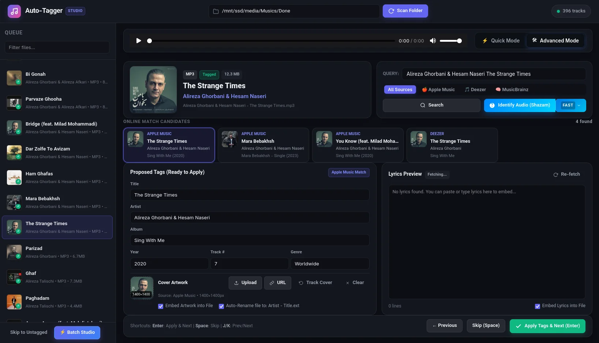
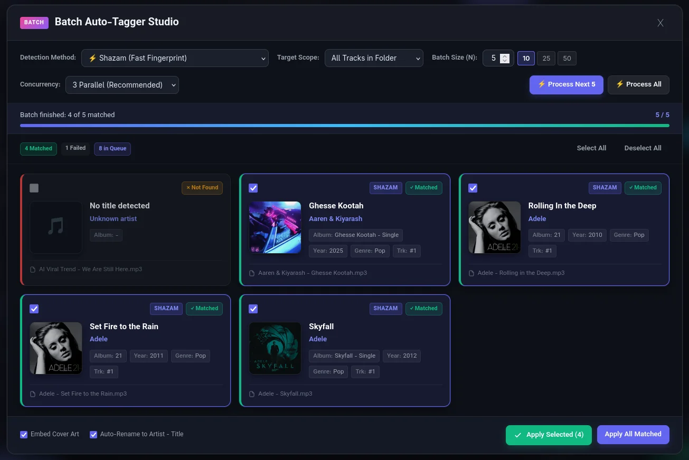

# 🎵 Metatune Studio

<p align="center">
  <strong>The sleek, self-hosted media tagging studio with Shazam superpowers.</strong>
</p>

<p align="center">
  <a href="LICENSE"></a>
  <a href="https://www.python.org/"></a>
  
  <a href="README.fa.md"></a>
</p>

> 🌍 **Language / زبان:** **English** | [فارسی (Persian)](README.fa.md)

A self-contained, lightning-fast, and sleek web-based studio (Dark Glassmorphic UI) for audio and music video metadata tagging, automatic song recognition (Shazam), online multi-source search, synced lyrics fetching, audio playback, and batch file organization.

<p align="center">
  
</p>

<p align="center">
  
</p>

---

## ✨ Features

- ⚡ **Automated Music Recognition (Shazam & Audio Fingerprinting):**
  - Instantly identifies song title, artist, and official high-resolution album artwork using audio analysis—even for untagged or poorly named music videos.
- 🎬 **Full Audio & Video Support:**
  - Complete metadata tagging and cover embedding for **Audio** (`MP3`, `FLAC`, `M4A`, `OGG`, `OPUS`, `WAV`) and **Video** (`MP4`, `MKV`, `WEBM`).
- 🔍 **Multi-Source Online Metadata Search:**
  - 🍎 **Apple iTunes API:** High-resolution 1200x1200px artwork, clean official tags, and release metadata.
  - 🎵 **Deezer API:** Global catalog coverage with XL 1000x1000px album covers.
  - 🧠 **MusicBrainz API:** Detailed metadata matching for rare, traditional, and international archives.
- 📝 **Synced Lyrics & Built-in Editor (LRC):**
  - Automatic lookup for synchronized (`.lrc`) or plain lyrics via LRCLib and lyrics databases.
  - In-browser lyrics editor for manual tweaks before writing tags or exporting `.lrc` files.
- ⚖️ **Side-by-Side Metadata Diff Preview:**
  - Clear visual comparison between current file metadata and suggested online tags before committing changes.
- 📤 **Direct File Upload & URL Downloader:**
  - Upload files directly through the browser or fetch audio/video from direct web links.
- 🏷️ **Smart File Renaming:**
  - Cleanly rename files according to standard patterns like `Artist - Title.ext`.
- ⌨️ **Keyboard-Driven Workflow:**
  - `Enter`: Apply tags and proceed to the next item
  - `Space`: Skip current item
  - `J` / `K` or Arrow keys: Navigate through the library

---

## 🚀 Quick Start & Native Launchers

This repository includes native dual-language TUI managers for Linux, macOS, and Windows.

### 🐧 Linux & macOS

```bash
chmod +x start.sh
./start.sh
```

The script automatically prepares the `.venv` virtual environment and dependencies if needed, starts the server, and opens your browser.

Optional flags & utilities:
```bash
./start.sh 8080            # Run on custom port (default: 7860)
./start.sh --no-browser    # Run without opening browser automatically
./start.sh install         # Explicitly setup virtualenv & install dependencies
./start.sh update          # Update dependencies to latest versions
./start.sh check           # System health check (Python, FFmpeg, tools)
```

### 🪟 Windows (PowerShell)

```powershell
.\start.ps1
```

Optional parameters:
```powershell
.\start.ps1 -Port 8080
.\start.ps1 -NoBrowser
.\start.ps1 -Action install
.\start.ps1 -Action update
.\start.ps1 -Action check
```

---

## 🛠️ Requirements & Manual Installation

The launcher automatically configures a virtual environment (`.venv`) and installs dependencies via Astral `uv` or `pip`.

```bash
# Manual installation if preferred:
python3 -m venv .venv
source .venv/bin/activate
pip install -r requirements.txt
python3 app.py
```

### Optional Dependencies
- **FFmpeg (`ffmpeg`):** Recommended for extracting audio from video files during Shazam recognition.
- **Chromaprint (`fpcalc`):** Optional for AcoustID fingerprinting.

---

## 📸 Screenshots

*(Add your UI screenshots or recordings here)*

---

## 📄 License

Distributed under the [MIT License](LICENSE).
